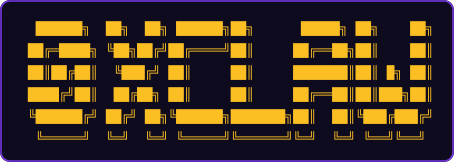

# 0xClaw

<div align="center">
  
</div>

<h3 align="center">Findings of EMNLP 2026</h3>
<p align="center"><strong>Autonomous open-ended agents with phase-aware budget allocation and temporal pressure</strong></p>

<hr>

<p align="center">
  <a href="https://aclanthology.org/2026.findings-emnlp.415/"></a>
  <a href="https://python.org"></a>
  <a href="LICENSE"></a>
  <a href="https://discord.gg/rdnYEVdRHe"></a>
</p>
<p align="center">
  <a href="https://aclanthology.org/2026.findings-emnlp.415/">📄 Paper</a> ·
  <a href="https://spiral.imperial.ac.uk/entities/publication/7a460786-fba9-4b42-b9a0-d128429f67e4">📝 Preprint</a> ·
  <a href="#citation">📚 BibTeX</a> ·
  <a href="https://0xclaw-ai.github.io/">🌐 Website</a>
</p>
<p align="center">
  <a href="https://github.com/0xclaw-ai/budget-router">🔀 BudgetRouter</a> ·
  <a href="https://github.com/0xclaw-ai/deadline-framer">⏱️ DeadlineFramer</a> ·
  <a href="https://github.com/0xclaw-ai/budget-router-trainer">🛠️ Training</a> ·
  <a href="https://huggingface.co/0xclaw-ai/budgetrouter-qwen3.5-2b-lora">🤗 Model</a> ·
  <a href="https://huggingface.co/datasets/0xclaw-ai/budgetrouter-hackrep">📊 Dataset</a>
</p>

## Introduction

**Give 0xClaw a hackathon URL — it researches, codes, tests, and prepares the submission on your machine.**
Its seven-phase workflow covers research, ideas, selection, planning, coding,
testing, and submission documents. Continue in chat to iterate on the finished project.

[BudgetRouter](https://github.com/0xclaw-ai/budget-router) and
[DeadlineFramer](https://github.com/0xclaw-ai/deadline-framer) are separately installed,
optional components for phase budgets and deadline guidance.

## 📰 News

- **Oct 2026** 📄 Our paper is published in [Findings of EMNLP 2026](https://aclanthology.org/2026.findings-emnlp.415/).
- **Oct 2026** 📦 [BudgetRouter](https://github.com/0xclaw-ai/budget-router) and [DeadlineFramer](https://github.com/0xclaw-ai/deadline-framer) are available as separately installed, optional components; see [installation below](#optional-budgetrouter-and-deadlineframer).
- **Aug 2026** 🎉 0xClaw was accepted to [EMNLP 2026](https://2026.emnlp.org/)!
- **Apr 2026** 🏆 1st Place Winner – Z.ai Bounty @ UK AI Agent Hackathon × OpenClaw 🦞.
- **Apr 2026** 🏆 Finalist Winner – Anyway Bounty @ UK AI Agent Hackathon × OpenClaw 🦞.

## Quick Start

Clone the repository and install it in a Python 3.11 environment:

```bash
git clone https://github.com/0xclaw-ai/0xClaw.git
cd 0xClaw
conda create -n 0xclaw python=3.11 -y
conda activate 0xclaw
pip install -e .
cp .env.example .env
./scripts/verify_setup.sh
```

Configure `.env` using the [setup guide](USAGE.md#-quick-start), then launch:

```bash
0xclaw
```

The example configuration uses the Z.ai Coding Plan endpoint. The guide covers
standard API accounts, provider keys, Claude Code, Node/npm, and optional tools.
Shell commands above use Bash; on Windows, copy `.env.example` to `.env` with
`Copy-Item .env.example .env` in PowerShell, and run the `.sh` scripts in Bash.

See [running the agent](USAGE.md#-run), [CLI commands](USAGE.md#-cli),
[model configuration](USAGE.md#-models), and [messaging channels](USAGE.md#-channels).

## Optional BudgetRouter and DeadlineFramer

The default installation runs without these components or their model dependencies.
Install either component independently, or both in the same Python environment as 0xClaw.

| Resource | Download and instructions | Purpose |
| --- | --- | --- |
| BudgetRouter | [Repository](https://github.com/0xclaw-ai/budget-router) | Local model inference and phase budget adjustment |
| DeadlineFramer | [Repository](https://github.com/0xclaw-ai/deadline-framer) | Deadline guidance from controls and prior phase usage |
| Training pipeline | [Repository](https://github.com/0xclaw-ai/budget-router-trainer) | Data preparation and LoRA training |
| Trained adapter | [Hugging Face Model](https://huggingface.co/0xclaw-ai/budgetrouter-qwen3.5-2b-lora) | LoRA weights for Qwen3.5-2B |
| Sanitized dataset | [Hugging Face Dataset](https://huggingface.co/datasets/0xclaw-ai/budgetrouter-hackrep) | Redacted splits, provenance, and source license notes |

For combined operation:

```bash
git clone https://github.com/0xclaw-ai/budget-router.git
git clone https://github.com/0xclaw-ai/deadline-framer.git
python -m pip install -e ./budget-router -e ./deadline-framer
```

Download both the base model and adapter following the
[model download guide](https://github.com/0xclaw-ai/budget-router/blob/main/USAGE.md#download-the-model),
then add their paths to the 0xClaw `.env`:

```dotenv
OXCLAW_PHASE_CONTROLS=budget-router,deadline-framer
OXCLAW_BUDGET_ROUTER_MODEL_PATH=./models/qwen3.5-2b
OXCLAW_BUDGET_ROUTER_ADAPTER_PATH=./models/budgetrouter-lora
```

Cloning the adapter does not download the base model. See the
[integration guide](USAGE.md#optional-budgetrouter-and-deadlineframer) for independent
use, disabling components, `/resume`, `/redo`, and logs. These hooks apply to the
interactive pipeline; gateway messages and legacy single-phase scripts do not use them.

## 👾 Demo Video

<div align="center">
  <a href="https://www.youtube.com/watch?v=jmamrAxRuec">
    
  </a>
</div>

See the [example prompts](USAGE.md#-demo-video) to run the workflow.

## License

Code and logo: [MIT](LICENSE), copyright 2026 0xClaw Team.
The Qwen base model and BudgetRouter adapter use Apache 2.0 under their separate
model terms. The dataset collection and original annotations use CC BY 4.0;
source-project material may have separate rights. See the
[dataset notice](https://huggingface.co/datasets/0xclaw-ai/budgetrouter-hackrep/blob/main/NOTICE.md).

## Citation

Read the [published paper](https://aclanthology.org/2026.findings-emnlp.415/) or the
[Imperial preprint](https://spiral.imperial.ac.uk/entities/publication/7a460786-fba9-4b42-b9a0-d128429f67e4).
If you find our work useful, please cite:

```bibtex
@inproceedings{zhou20260xclaw,
  title={0xClaw: Autonomous Open-ended Agents with Phase-aware Budget Allocation and Temporal Pressure},
  author={Zhou, Yu and Dou, Xinyuan and Cao, Yudong and Song, Junhao},
  booktitle={Findings of the Association for Computational Linguistics: EMNLP 2026},
  pages={8753--8769},
  year={2026}
}
```

---

<p align="center">
  <a href="https://z.ai"></a>
  <a href="https://flock.io"></a>
</p>

<div align="center">



</div>

<div align="center">
<sub>Built for <a href="https://dorahacks.io/hackathon/1985">UK AI Agent Hackathon EP4</a> in collaboration with 🦞 <a href="https://github.com/openclaw/openclaw">OpenClaw</a>  · Thanks to 🐈 <a href="https://github.com/HKUDS/nanobot">Nanobot</a> framework</sub>
</div>
